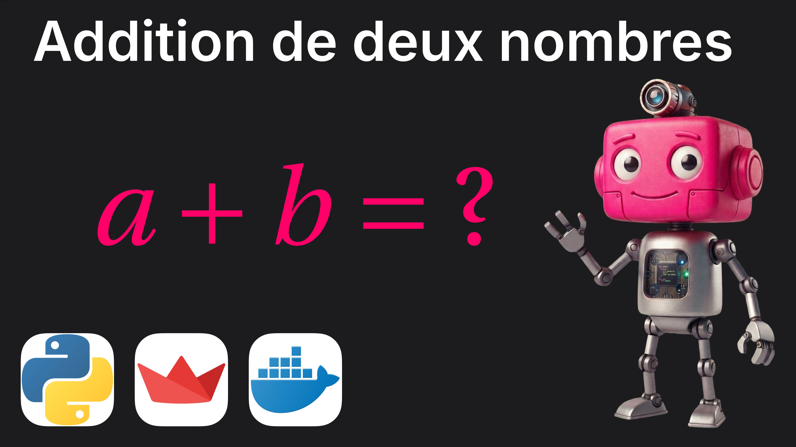

# Addition

Mini-application Streamlit : deux nombres, un bouton, leur somme.

Elle sert surtout à valider de bout en bout la chaîne de déploiement :
du code Python au conteneur Docker, servi en HTTPS sur mon propre serveur.

- **Démo en ligne :** https://addition.bejian.fr
- **Portfolio :** https://bejian.fr

## Lancer en local

    uv sync
    uv run streamlit run app.py

## Lancer avec Docker

    docker build -t addition .
    docker run -p 8501:8501 addition

## Déploiement

Image Docker sur un VPS, derrière un reverse proxy Caddy (HTTPS automatique).

## Stack

Python 3.14 · Streamlit · uv · Docker · Caddy

---

Pierre BÉJIAN · [bejian.fr](https://bejian.fr)
